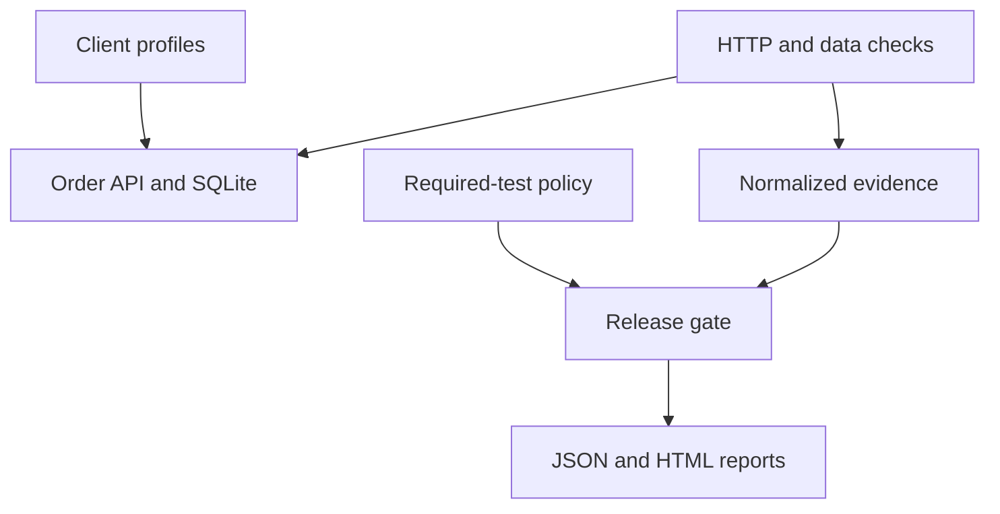

# Release Quality Platform

A working QA engineering portfolio demonstrating evidence-based release gates across three synthetic client configurations. Built with Python's standard library, a loopback HTTP API, SQLite, and GitHub Actions.

**Implemented:** API and persisted-data checks, client-scoped configuration, normalized results, fail-closed release policy, HTML reports, automated regression experiment, and CI workflow.

**Planned:** Robot Framework UI workflows, historical reliability analysis, risk-based selection, and dashboard history. The repository name reflects the intended UI expansion; this first version has no UI suite.

## Quick start
Requires Python 3.12 or newer. No third-party packages, account, credentials, or external service are required.

```bash
git clone https://github.com/mahirqa45/robot-framework-qa.git
cd robot-framework-qa
git switch feature/ui-automation
python -m unittest discover -s tests -v
python -m quality.run
python -m quality.demo
```

Open `reports/latest/report.html` in a browser. The demonstration writes separate reports under `reports/demo/baseline`, `reports/demo/defect`, and `reports/demo/restored`.

## Release decision demonstration

```bash
# Expected exit code 0: complete passing release
python -m quality.run --out reports/baseline
# Expected exit code 1: Beacon discount regression blocks release
python -m quality.run --inject-discount-defect --out reports/defect
# Expected exit code 0: verifies PASS -> BLOCK -> PASS and client isolation
python -m quality.demo
```

The restored scenario disables an injected synthetic defect; it does not claim an actual production fix. A client-only run (`--client beacon`) is explicitly labeled `client-only` and cannot certify the full release.

## Business rules
All amounts use integer minor currency units. Discounts apply before tax, with half-up rounding. Approval is required strictly above the client's threshold.

| Client | Discount | Tax | Allowed order roles | Approval threshold |
|---|---:|---:|---|---:|
| Atlas | 0% | 0% | buyer, admin | 100000 |
| Beacon | 10% | 0% | buyer, admin | 50000 |
| Cedar | 0% | 18% | admin | 75000 |

Each client has six required checks: pricing (including rounding), allowed/denied roles, persistence, cross-client isolation, invalid inputs, and approval boundaries. The full run produces 18 check records; each check can include multiple assertions.

## Architecture



The result collector records client, test ID, status, duration, attempt history, and diagnostic details. The policy engine requires every expected check exactly once and rejects failures, errors, skips, unknown statuses, mismatched histories, missing clients, and incomplete execution. Failed retry attempts remain blocking. CI runs client jobs and then independently reruns all checks for the full release gate.

## Run the sample API separately

```bash
python -m app.server --port 8000 --database orders.sqlite
```

`GET /health`, `POST /clients/{client}/orders`, and `GET /clients/{client}/orders/{id}` are supported. Example POST body: `{"role":"buyer","unit_price":10000,"quantity":2}`.

The API binds to loopback. Role fields simulate authorization rules; there is no real identity/authentication, production tenant security, or deployment configuration. Do not deploy this sample as a production service.

## Engineering evidence
- `tests/test_gate.py`: adversarial policy cases, including missing coverage and retry masking.
- `tests/test_integration.py`: real HTTP runs, scoped failures, report generation, and database restart.
- `docs/strategy.md`: test strategy, constraints, and next milestones.
- `.github/workflows/quality.yml`: unit/integration checks, client matrix, full release gate, and retained artifacts.

Generated reports and local databases are excluded from Git. All clients and data are fictional. No production impact or time-saving metrics are claimed.
